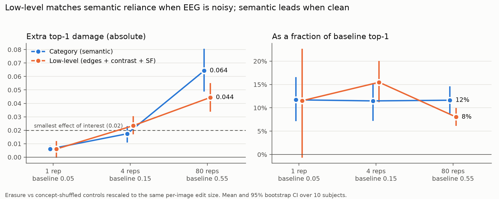
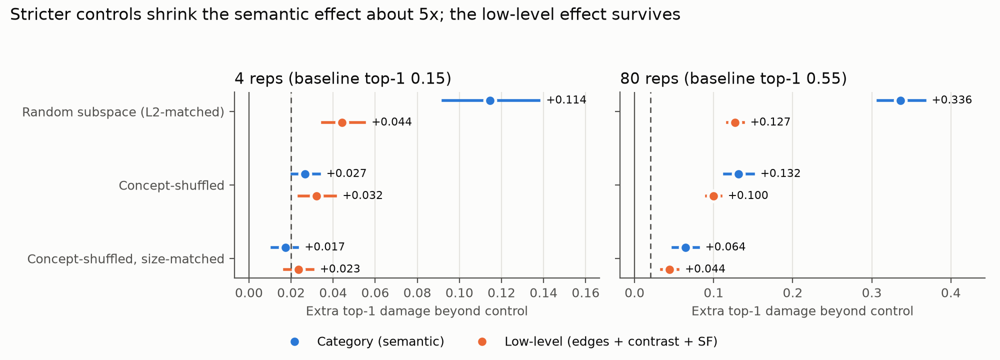

# Controlled erasure: go/no-go summary (Nov 20)

**Recommendation: GO**, with a modest-effect framing.

## Question

When a frozen NeuroBridge EEG→CLIP decoder retrieves the right image, how much does it rely on
semantic information (object category) versus low-level image statistics (edges, contrast,
spatial frequency)? And does that balance depend on how noisy the EEG is?

## Setup

- THINGS-EEG2, 10 subjects. One 63-channel NeuroBridge teacher per subject (trained locally on
  CPU; reproduces the GPU run). 200-image test gallery, so chance top-1 = 0.005.
- **Intervention:** project out the train cross-covariance span of a property from the EEG
  embedding, before normalization. Probes are refit after each edit to confirm the property was
  removed.
- **Targets:**
  - category: 28 coarse classes, rank 27;
  - low-level: edges, contrast and spatial frequency erased together as one target, rank 3.
- **Noise levels:** test EEG averaged over 1, 4 or 80 repetitions (baseline top-1 0.05 / 0.15 / 0.55).
- **Controls, weakest to strictest:**
  1. random subspace of the same rank and per-image L2;
  2. 10 concept-shuffled copies of the label;
  3. those shuffled copies rescaled to the real edit's per-image L2 (size-matched).
- The analysis settings and the 0.02 smallest effect of interest were frozen on the sub-08 pilot.

## Result

The table shows extra top-1 damage beyond the size-matched shuffled controls, with the mean
and 95% bootstrap CI over the 10 subjects.

| Repetitions | Low-level | Category | Low-level − category (paired) |
|---|---|---|---|
| 1 | +0.006 [−0.000, 0.012] | +0.006 [0.004, 0.009] | 0.000 [−0.008, 0.007] |
| 4 | **+0.023** [0.017, 0.030], 10/10 subjects | +0.017 [0.011, 0.023], 9/10 | +0.006 [−0.002, 0.014] |
| 80 | **+0.044** [0.034, 0.055], 10/10 | **+0.064** [0.049, 0.081], 10/10 | −0.020 [−0.034, −0.009] |



1. **Naive controls overstate semantic reliance about 5×.**
   - At 80 repetitions, category damage falls from +0.336 (random controls) to +0.132 (shuffled)
     to +0.064 (size-matched).
   - Any data-fitted erasure removes concept-identity structure. Random subspaces do not capture
     that, so they inflate the effect.
2. **The decoder uses a separable low-level family.**
   - Erasing the three low-level descriptors removes them (the refit probes drop to chance) and
     hurts retrieval beyond every control.
   - It leaves category information nearly intact at 4 and 80 repetitions: 1–14% extra loss, below the 25% collateral
     tolerance.
   - The reverse does not hold: erasing category also strips about half the low-level
     information.
3. **The balance depends on noise.**
   - With noisy EEG (4 repetitions), low-level damage is as large as category damage: 15% vs 11%
     of baseline.
   - With clean EEG (80 repetitions), category leads: 12% vs 8%.



## Montage contrast: Crown vs occipital (8 channels each)

- **Models:** one no-distillation student per subject and montage (`train_student.py
  --condition none`). Each uses the 63-channel teacher's frozen image projector, so all models
  share an embedding space and gallery.
- **Baselines at 80 reps:** top-1 is 0.16 for crown8, 0.54 for occipital8 and 0.55 for the
  teacher. Because these differ about 3×, damage is compared as a fraction of each subject's
  baseline.
- **At 80 repetitions** (extra damage beyond size-matched shuffles, as a share of baseline;
  mean and 95% CI over 10 subjects):

| | Low-level | Category | Low-level − category |
|---|---|---|---|
| crown8 | 33% [28, 38] | 19% [15, 23] | +14 pts [+8, +21], 9/10 subjects |
| occipital8 | 8% [5, 11] | 15% [12, 17] | −7 pts [−11, −3], 8/10 subjects |
| crown8 − occipital8 | +25 pts [+19, +29] | +4 pts [−1, +9] | **+21 pts [+15, +28], 10/10 subjects** |

4. **The Crown montage's decoder leans on low-level image statistics; occipital's does not.**
   - At equal channel count, erasing low-level information costs the crown8 decoder a third of
     its accuracy. It costs the occipital8 decoder 8%, close to the 63-channel teacher (7%).
   - Semantic reliance is about the same for both montages.
   - So the Crown's channels do not just carry less of the same information. The information
     they carry is a different mix.
   - Caveats specific to this contrast:
     - At 1 and 4 repetitions the crown8 baseline is near the floor (0.01 and 0.03), so only the
       80-repetition contrast can be read.
     - In crown8, the low-level erasure also removes 26% of category probe accuracy, just past
       the 25% collateral tolerance. The two are more entangled in the Crown embedding, so part
       of the low-level damage may be semantic.
     - One training seed per student.
   - **Implication for distillation:** a teacher that relies on semantic information is the
     thing a Crown student is missing. The next test is whether response distillation from the
     teacher shifts the crown8 student's balance toward occipital8's.

## Distilled Crown students: response KD does not change the balance

- **Models:** one crown8 student per subject trained with response distillation from that
  subject's 63-channel teacher (`--condition response`: embedding + KL, tau 4). It shares
  the teacher's frozen image projector, like the no-distillation students.
- **Effect of distillation itself (paired, 9 subjects with both):** top-1 rises 15.9% → 17.1%
  (+1.2 pts, 7/9 subjects). Cosine agreement with the teacher rises from 0.34 to 0.42.
- **At 80 repetitions** (relative excess vs size-matched shuffles, 10 subjects):

| | Low-level | Category | Low-level − category |
|---|---|---|---|
| crown8, distilled | 30% [23, 37] | 16% [11, 20] | +14 pts [+6, +24], 8/10 subjects |
| crown8, no distillation | 33% [28, 38] | 19% [15, 23] | +14 pts [+8, +21], 9/10 |
| distilled − no distillation | −3 pts [−9, +2] | −4 pts [−8, 0] | **0 pts [−6, +5]** |
| distilled crown8 − occipital8 | +22 pts [+15, +29] | +1 pt [−5, +5] | +21 pts [+13, +31], 10/10 |

5. **Response distillation leaves the Crown student's reliance pattern unchanged.**
   - Both shares shrink slightly and by the same amount, so the low-level lean stays at
     +14 pts. The gap to occipital8 (+21 pts) is the same as without distillation.
   - The Crown low-level lean replicates on a second, independently trained set of students.
   - So the small accuracy gain from distillation does not come from borrowing the teacher's
     semantic reliance. The lean looks like a property of what the Crown channels record.
   - Caveat: this KD recipe moves the student only a little (+1.2 pts top-1). A recipe that
     changes the student more (feature or relational KD) is the untested alternative.
   - In the distilled student the low-level erasure removes 23% of category probe accuracy,
     just under the 25% tolerance (26% without distillation).

## Caveats

- **The effects are small.** At 4 repetitions the low-level mean clears 0.02, but the lower end
  of its CI (0.017) does not.
- **At 1 repetition everything is below 0.02.** That noise level supports no claim either way.
- **Low-level means the family, not single descriptors.** At 80 repetitions, edges alone and
  spatial frequency alone fall to about +0.01 under size-matched controls. The descriptors are
  too entangled to separate.
- **Size matching is a conservative control.** The shuffled edit is pushed past its own
  projection, which can overstate generic damage. Results under both shuffled controls are shown.
- **Untested so far:**
  - only one decoder architecture (NeuroBridge, CLIP RN50 targets);
  - only one coarse category scheme.

## Talk headline

> Strict controls cut apparent semantic reliance in EEG image decoding about 5×. What remains is
> semantic plus low-level image statistics, and when the EEG is noisy the low-level share is as
> large as the semantic one.

## Next steps

1. Optional: a stronger KD recipe (feature or relational) on crown8, to check whether any
   distillation that moves the student more also moves its balance.
2. Turn the figures into talk slides, adding a montage figure (crown8, distilled crown8,
   occipital8 and the teacher side by side).

## Reproduce

```bash
ANNOT=$PWD/data/things_eeg/image_set/annotations.csv OUT=$PWD/results/erasure_sm \
  bash scripts/erasure_all_subjects.sh
python mi_verdict.py results/erasure_sm/sub-*.json --sesoi 0.02 \
  --probe-chance coarse_category=0.0357 --size-matched > results/verdicts_sm_10sub.json
python scripts/plot_erasure_summary.py results/verdicts_sm_10sub.json
ANNOT=... OUT=$PWD/results/erasure_montage MONTAGES="crown8 occipital8" \
  bash scripts/erasure_all_subjects.sh
python mi_verdict.py results/erasure_montage/crown8/sub-*.json \
  --vs results/erasure_montage/occipital8/sub-*.json --sesoi 0.02 \
  --probe-chance coarse_category=0.0357 --size-matched > results/verdicts_crown_vs_occ_10sub.json
ANNOT=... OUT=$PWD/results/erasure_montage MONTAGES="crown8@response" \
  bash scripts/erasure_all_subjects.sh
python mi_verdict.py results/erasure_montage/crown8_response/sub-*.json \
  --vs results/erasure_montage/crown8/sub-*.json --sesoi 0.02 \
  --probe-chance coarse_category=0.0357 --size-matched > results/verdicts_kd_vs_nokd_10sub.json
```

The code is at commit `080bfb4` on branch `claude/superpowers-tdd-review-70a7a1`. The full run
takes about 2 hours on an M4 Pro CPU.
